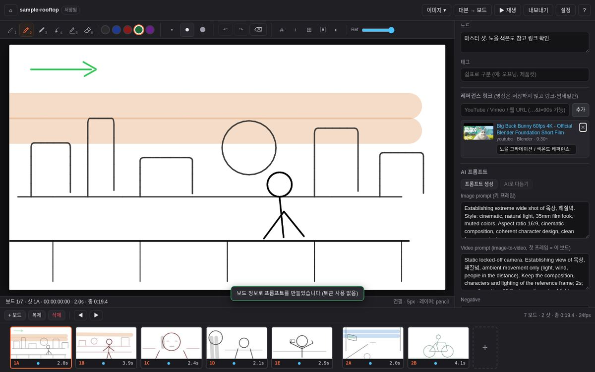
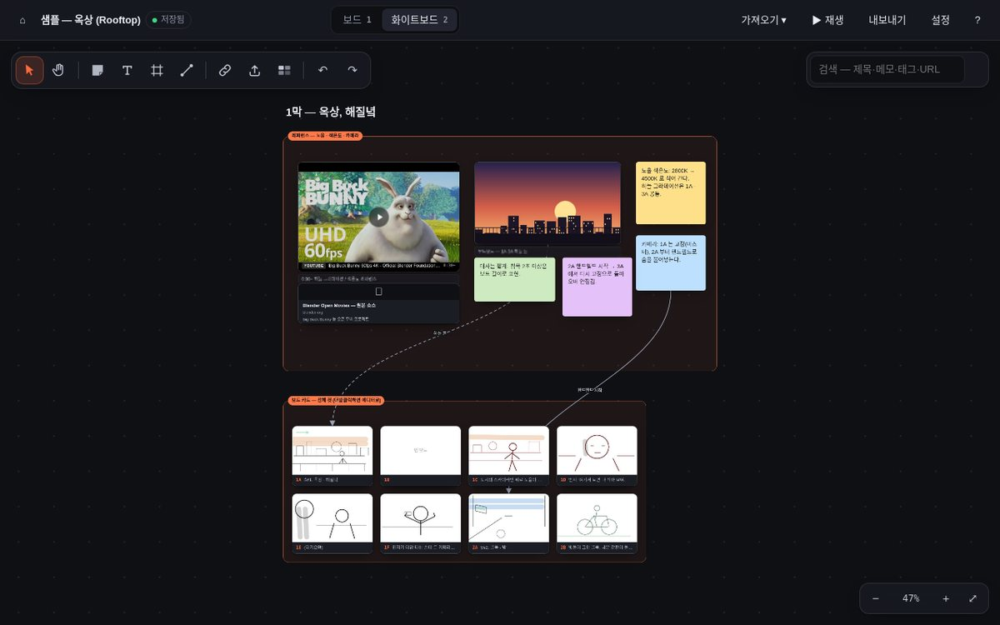

# Storyboarder Next

> 기획의 흐름을 먼저 잡고, 그 위에 AI를 얹는다.

[wonderunit/storyboarder](https://github.com/wonderunit/storyboarder)(Electron, 2022년 이후 업데이트 중단)의 **정신과 파일 포맷을 계승**한, Node.js + 브라우저 기반 스토리보드(콘티) 툴입니다.
엑셀·슬라이드로 하던 콘티 작업을 "그림 + 정보(영상 링크·샷 정보·프롬프트)"가 한 덩어리로 묶인 보드로 옮기고, 그 보드를 그대로 AI(이미지/영상 생성)의 입력으로 넘기는 것이 목표입니다.

```
레퍼런스 영상 → (분석기) → 샷/자막 데이터 ─┐
레퍼런스 화이트보드(이미지·유튜브·메모) ────┤
대본/메모 ─────────────────────────────────┴→  보드(콘티 그림 + 샷 정보 + 링크)  →  프롬프트 팩  →  AI 영상 (Higgsfield 등)
                                                  ↑ 여기(기획)에 시간을 쓰고, 토큰은 확정된 컷에만 씁니다.
```



## v0.2 에서 새로 된 것

| 영역                        | 기능                                                                                                                                                                                                                                                                             |
| ------------------------- | ------------------------------------------------------------------------------------------------------------------------------------------------------------------------------------------------------------------------------------------------------------------------------ |
| **레퍼런스 화이트보드** (`Ctrl+2`) | 프로젝트마다 하나 있는 무한 캔버스. 이미지·영상·PDF 를 끌어다 놓고(업로드, `assets/`), YouTube/Vimeo 링크를 붙여 넣으면 **바로 재생되는 임베드**, 스티키 노트·텍스트·프레임(그룹)·연결선, 스토리보드 **보드 카드**(더블클릭 → 에디터), 검색·되돌리기·자동 저장. 이미지 카드는 현재 보드의 **레퍼런스 레이어**로, 링크 카드는 **보드 링크**로 보냅니다                                                   |
| **영상 분석 결과 → 보드**         | 분석 파이프라인(PySceneDetect · Whisper · VLM 등)이 만든 **샷/자막 JSON**, PySceneDetect **CSV**, **SRT/VTT** 를 붙여 넣으면 샷 하나 = 보드 하나. 샷 타입·카메라 무브 어휘 자동 매핑(한국어 포함), 자막 → 대사, 원본 영상의 **시작 시간으로 점프하는 링크**, `ext.source` 출처, 화이트보드에 카드로도 배치 → [docs/ANALYSIS_IMPORT.md](docs/ANALYSIS_IMPORT.md) |
| 가져오기 ▾ 메뉴                 | 이미지 → 레퍼런스/새 보드 · 대본/텍스트 → 보드 · 영상 분석 결과 → 보드 를 한 메뉴로                                                                                                                                                                                                                          |
| 디자인                       | 홈 화면·에디터 재디자인(다크, 카드형 홈, 보드/화이트보드 전환 탭)                                                                                                                                                                                                                                        |
| 내보내기                      | ZIP 번들에 `whiteboard.md`(프레임별 레퍼런스 목록) + 화이트보드가 참조하는 `assets/` 포함                                                                                                                                                                                                               |
| 설계 문서                     | [docs/VIDEO_INTELLIGENCE.md](docs/VIDEO_INTELLIGENCE.md) — 영상 분석 파이프라인(샷 분할·ASR·VLM 설명·검색·LLM 편집 에이전트)의 데이터 모델과 오픈소스 스택, 이 앱과의 접점                                                                                                                                              |



## 무엇이 되나 (v0.1 부터)

| 영역       | 기능                                                                                                                                                                        |
| -------- | ------------------------------------------------------------------------------------------------------------------------------------------------------------------------- |
| 그리기      | 연한 연필 / 연필 / 펜 / 브러시 / 노트 펜 / 지우개, 3단계 굵기, 팔레트, 필압(펜 태블릿·iPad), Shift 직선, 스포이드, 실행 취소/다시 실행, 레이어(reference · fill · tone · pencil · ink · notes), 어니언 스킨, 가이드(그리드·센터·3분할) |
| 보드       | 새 보드 · 복제 · 삭제 · 드래그 순서 변경 · 샷 묶기(1A, 1B, 2A …) · 길이(ms) · 타임코드                                                                                                           |
| 정보       | 액션 / 대사 / 노트 / 태그 / **샷 타입(EWS~ECU)** / **카메라 무브** / 상태(draft→approved)                                                                                                   |
| 레퍼런스 링크  | YouTube · Vimeo · 일반 웹 URL 을 보드에 첨부 (제목·썸네일·시작 시간 자동 추출, **영상 파일은 저장하지 않음**)                                                                                              |
| 대본 → 보드  | Fountain / 한국어 대본 / 메모를 붙여 넣으면 씬·대사·지문 단위로 보드 자동 생성 (미리보기 포함)                                                                                                             |
| 이미지 가져오기 | Figma · Krita · Blender(Grease Pencil) 렌더 등 PNG/JPG 를 레퍼런스 레이어 또는 새 보드로 (드래그 앤 드롭)                                                                                        |
| 재생       | 애니매틱 재생(보드 길이 기준), 타임코드                                                                                                                                                   |
| 인쇄       | 브라우저 인쇄 → PDF 콘티 시트 (3×2, 액션/대사/노트)                                                                                                                                       |
| 내보내기     | ZIP 번들 · 샷 리스트 CSV(엑셀 호환) · 프롬프트 팩 Markdown/JSON · 원작 호환 `.storyboarder`                                                                                                  |
| AI (선택)  | 보드 정보로 **오프라인 프롬프트 생성**(토큰 0) → OpenAI 호환 API 로 다듬기 → Higgsfield image-to-video 요청/폴링                                                                                     |
| 호환       | 원작 Storyboarder 프로젝트 폴더를 `projects/` 에 복사하면 그대로 열림                                                                                                                        |

## 빠른 시작

```bash
git clone <this repo> && cd storyboarder-next
npm install            # 의존성은 express 하나뿐
npm start              # http://localhost:3000
```

- 샘플 프로젝트 `projects/sample-rooftop` 이 포함되어 있어 바로 눌러볼 수 있습니다(보드 8개 + 레퍼런스 화이트보드).
- 영상 분석 결과 가져오기는 `가져오기 ▾ → 영상 분석 결과 → 보드 → 예시 JSON 넣기` 로 분석기 없이도 바로 체험할 수 있습니다.
- 같은 Wi-Fi 의 iPad/태블릿에서 `http://<PC IP>:3000` 으로 접속하면 Apple Pencil 필압으로 그릴 수 있습니다.
- AI 연동은 `.env.example` 을 `.env` 로 복사해 키를 넣으면 켜집니다 → [docs/AI_INTEGRATION.md](docs/AI_INTEGRATION.md)

## 검증

```bash
npm test          # 유닛 + API 테스트 (node:test, 61개: 보드·대본·링크·프롬프트·PNG·분석 가져오기·화이트보드 + HTTP API)
npm run lint      # 모든 JS 문법 검사 + HTML 참조 파일 존재 확인
npm run test:e2e  # Playwright 브라우저 스모크 테스트 (18단계, 스크린샷 tests/e2e/output/)
```

`test:e2e` 는 Playwright 가 필요합니다(저장소에는 포함하지 않음) → [docs/DEPLOY.md](docs/DEPLOY.md#e2e-테스트-playwright).

## 폴더 구조

```
server/            Express 서버 (REST API, 프로젝트 저장소, 대본·분석 결과 파서, 화이트보드 모델, 프롬프트 빌더, AI 프로바이더)
public/            브라우저 앱 (의존성 없는 ES 모듈, 캔버스 드로잉 엔진, 화이트보드)
projects/          프로젝트 데이터 (폴더 하나 = 프로젝트 하나, 원작과 같은 구조 + assets/)
docs/              가이드 문서 (아래 목록)
tests/             node:test 유닛/API 테스트, Playwright e2e
scripts/           보조 스크립트 (문법 검사)
```

## 문서

| 문서                                                       | 내용                                                                           |
| -------------------------------------------------------- | ---------------------------------------------------------------------------- |
| [docs/GUIDE.md](docs/GUIDE.md)                           | 사용 설명서: 화면 구성, 화이트보드, 가져오기, 단축키, 기획→콘티→AI 워크플로                               |
| [docs/ANALYSIS_IMPORT.md](docs/ANALYSIS_IMPORT.md)       | 영상 분석 결과 가져오기: 받아들이는 형식(JSON/CSV/SRT/VTT), 필드 이름 규칙, 샷 타입·카메라 어휘 매핑표         |
| [docs/VIDEO_INTELLIGENCE.md](docs/VIDEO_INTELLIGENCE.md) | 영상 분석 파이프라인 설계: 데이터 모델, 오픈소스 스택, 단계별 계획, 이 앱과의 연결                            |
| [docs/AI_INTEGRATION.md](docs/AI_INTEGRATION.md)         | 텍스트 AI / Higgsfield 연결, 공개 URL(터널), 다른 AI 툴(Kling·Runway·Veo 등)에 프롬프트 팩 쓰는 법 |
| [docs/FILE_FORMAT.md](docs/FILE_FORMAT.md)               | `.storyboarder` 파일 포맷과 우리가 추가한 `ext` 필드(화이트보드, 출처), 이미지·에셋 파일 규칙             |
| [docs/API.md](docs/API.md)                               | REST API 레퍼런스 (자동화 스크립트용)                                                    |
| [docs/DEPLOY.md](docs/DEPLOY.md)                         | 로컬/LAN/서버 실행, 터널, Docker, Playwright 설치                                      |
| [docs/ROADMAP.md](docs/ROADMAP.md)                       | 다음에 하나씩 붙일 기능 목록과 설계 메모                                                      |

## 설계 원칙

1. **기획이 먼저.** 그림은 거칠어도 되고, 대신 샷 정보·레퍼런스·의도(노트)가 보드에 붙어 있어야 합니다. AI 프롬프트는 그 정보에서 자동으로 만들어집니다.
2. **토큰을 아낀다.** 프롬프트 생성은 서버 안에서 규칙 기반으로(무료) 먼저 하고, LLM 다듬기와 영상 생성은 사용자가 버튼을 누른 컷에만 씁니다.
3. **무거운 것은 저장하지 않는다.** 레퍼런스 영상은 링크+썸네일 URL 만(화이트보드의 유튜브도 임베드일 뿐), 외부 라이브러리는 CDN/문서 링크로. 직접 올린 파일만 `assets/` 에 두고, 참조가 끊기면 자동 정리합니다.
4. **분석은 바깥에서, 결과만 받는다.** 영상 분석(샷 분할·음성 인식·VLM)은 ffmpeg/GPU 가 있는 환경에서 돌리고, 이 앱은 그 결과 파일(JSON/CSV/SRT)만 읽습니다 — 서버 의존성은 그대로 express 하나.
5. **파일은 사람이 읽을 수 있게.** 프로젝트는 JSON + PNG 폴더이며 git 으로 관리할 수 있습니다(PNG 는 저장 시 무손실 재압축).
6. **의존성 최소.** 서버 런타임 의존성은 `express` 하나, 프런트엔드는 프레임워크 없이 ES 모듈.

## 라이선스와 원작에 대하여

- 이 저장소의 코드는 **MIT** 입니다.
- 원작 [wonderunit/storyboarder](https://github.com/wonderunit/storyboarder) 는 저장소에 오픈소스 LICENSE 파일이 없고 `package.json` 이 Wonder Unit 의 자체 EULA(`build/license_en.txt`)를 가리킵니다. 그래서 **원작 소스 코드는 한 줄도 복사하지 않았고**, 공개 문서로 알 수 있는 동작(도구 구성, 단축키 관례)과 `.storyboarder` JSON 파일 포맷만 호환되도록 독자적으로 다시 구현했습니다(clean-room).
- Storyboarder 는 Wonder Unit 의 상표일 수 있습니다. 이 프로젝트는 Wonder Unit 과 무관합니다.

## 기여 / 관리

- 이슈·PR 환영. 기능 추가는 [docs/ROADMAP.md](docs/ROADMAP.md) 의 순서를 참고해 하나씩.
- 커밋 전 `npm test && npm run lint`.
