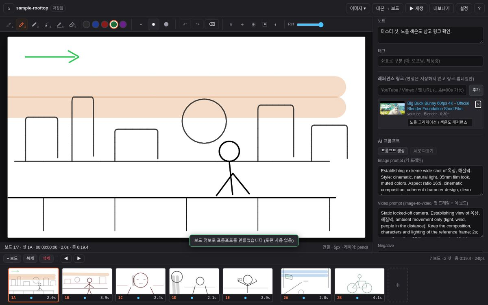
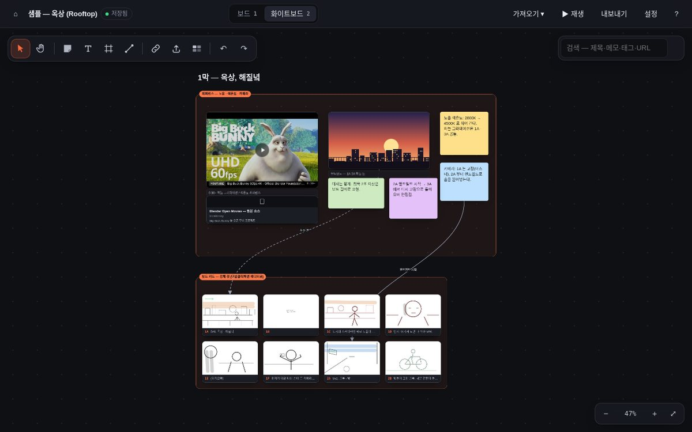

# 사용 가이드

## 1. 화면 구성



```
┌ 상단바 ───────────────────────────────────────────────────────────────┐
│ ⌂  프로젝트명  저장됨   [보드 1 | 화이트보드 2]   가져오기▾ ▶재생 내보내기 설정 ? │
├ 도구바 ──────────────────────────────────────────────┬────────────────┤
│ 1~6 도구 · 팔레트 · 굵기 · 되돌리기 · 지우기 · 가이드 · Ref 투명도    │  인스펙터        │
├ 캔버스 ──────────────────────────────────────────────┤  (보드 정보,    │
│                                                      │   레퍼런스 링크,│
│          보드 그림 (화면비에 맞춘 종이)                 │   AI 프롬프트)  │
│                                                      │                │
├ 보드 정보줄 ──────────────────────────────────────────┤                │
│ 보드 3/10 · 샷 2A · 00:00:04:12 · 2.0s · 총 0:21.3    도구 · 굵기 · 레이어│
├ 타임라인 ────────────────────────────────────────────────────────────┤
│ [+보드][복제][삭제] ◀ ▶          [1A 2.0s][1B 3.9s][2A …][ + ]        │
└──────────────────────────────────────────────────────────────────────┘
```

- **홈 화면**: 새 프로젝트 만들기(이름·화면비·FPS·기본 보드 길이·비주얼 스타일) + 프로젝트 목록.
- **보기 전환** (상단 가운데, `Ctrl/⌘+1` · `Ctrl/⌘+2`): **보드** 에디터와 **화이트보드**(레퍼런스 무한 캔버스, [§6](#6-레퍼런스-화이트보드)) 를 오갑니다. 둘 다 같은 프로젝트에 저장됩니다.
- **가져오기 ▾**: 이미지(레퍼런스 레이어 / 새 보드) · 대본/텍스트 → 보드 · **영상 분석 결과 → 보드**([§5-1](#5-1-영상-분석-결과--보드)) · **영상 → 장면별 스토리보드**([§5-2](#5-2-영상--장면별-스토리보드-영상-주소만-있을-때)).
- **저장 표시**: 그림·정보는 입력을 멈추면 자동 저장됩니다(`저장 중…` → `저장됨`). `Ctrl/⌘+S` 로 즉시 저장.

## 2. 그리기

| 도구 (단축키) | 용도 |
|---|---|
| 연한 연필 `1` | 러프 레이아웃 (pencil 레이어, 연한 회색) |
| 연필 `2` | 선 스케치 (pencil 레이어, 필압에 따라 굵기·농도) |
| 펜 `3` | 확정 선 (ink 레이어) |
| 브러시 `4` | 면·톤 (tone 레이어, 반투명 넓은 붓) |
| 노트 펜 `5` | 연출 메모·화살표 (notes 레이어 — **AI 에 보내는 합성 이미지에서는 제외**) |
| 지우개 `6` | 현재 도구의 레이어만 지움 |

- 굵기 3단계: 도구바의 ● 버튼 또는 `[` `]`.
- 색: 팔레트 5색 (도구별로 기억). `Alt+클릭` 으로 캔버스에서 색 추출.
- `Shift+드래그` 직선. `Ctrl/⌘+Z` 되돌리기, `Ctrl/⌘+Shift+Z` 또는 `Ctrl/⌘+Y` 다시 실행.
- `Delete`/`Backspace`: 현재 도구 레이어 지우기(해당 보드만). `Shift+Delete`: 보드 삭제.
- 가이드: `G` 그리드 · `C` 센터 · `T` 3분할 · `O` 어니언 스킨(이전/다음 보드 겹쳐 보기).
- **레퍼런스 레이어**: `이미지 ▾ → 현재 보드의 레퍼런스 레이어로` 또는 캔버스에 이미지를 드롭. 도구바의 `Ref` 슬라이더로 투명도 조절. Figma 프레임, Krita 스케치, Blender Grease Pencil 렌더 등을 밑그림으로 깔고 그 위에 그리는 용도입니다.
- 터치 기기: 기본은 손가락으로도 그려집니다. 펜만 그리게 하려면 `설정 → 터치로도 그리기` 해제.

### 레이어 구조

```
notes      연출 메모 (합성/썸네일에는 보이지만 AI 입력 이미지엔 제외)
ink        펜
pencil     연필
tone       브러시
fill       (예약: 채우기)
reference  가져온 이미지
```

각 레이어는 `projects/<id>/images/board-<번호>-<UID>-<레이어>.png` 로 따로 저장되고, 합성본 `board-<번호>-<UID>.png` 이 AI 입력과 내보내기에 쓰입니다.

## 3. 보드와 샷

- `N` 새 보드(현재 보드 뒤), `D` 복제, `←` `→` 이동, 타임라인 카드를 드래그하면 순서 변경.
- **새 샷 체크** (인스펙터 상단): 켜면 샷 번호가 올라갑니다. `1A 1B 1C | 2A 2B …` — 같은 샷 안의 보드는 같은 숫자 + 다른 알파벳. 원작과 같은 규칙입니다.
- **길이(ms)**: 비워 두면 프로젝트 기본값. 타임코드와 총 길이는 자동 계산.
- 인스펙터 필드
  - 액션 / 대사 / 노트 / 태그(쉼표 구분)
  - **샷 타입**: EWS · WS · FS · MS · MCU · CU · ECU · OTS · POV · TWO · INSERT · LOW · HIGH · BIRD · DUTCH
  - **카메라 무브**: static · pan-left/right · tilt-up/down · dolly-in/out · truck-left/right · crane-up/down · handheld · zoom-in/out · orbit · rack-focus · follow · whip-pan
  - **상태**: draft → ready → generating → generated → approved (AI 파이프라인 진행 표시용)

## 4. 레퍼런스 링크 (영상 정보 끌어오기)

인스펙터의 **레퍼런스 링크** 에 URL 을 붙여 넣고 `추가`:

- YouTube: `https://youtu.be/ID?t=90` / `watch?v=ID&t=1m30s` → 제목·채널·썸네일·시작 시간(1:30~) 추출, 임베드 URL 저장.
- Vimeo: 제목·작성자·썸네일.
- 일반 웹페이지: OpenGraph 제목/이미지.
- 각 링크에 **메모**(예: "노을 그라데이션 참고")를 적을 수 있고, 프롬프트 팩/Markdown 내보내기에 함께 나갑니다.
- 영상 파일은 저장하지 않습니다. 링크와 썸네일 URL 만 보관하므로 저장소가 무거워지지 않습니다.
- 서버가 인터넷에 못 나가는 환경이면 `.env` 에 `LINK_PREVIEW_OFFLINE=1` — URL 규칙으로 알 수 있는 정보(ID, 썸네일 URL, 시작 시간)만 채웁니다.

## 5. 대본 → 보드

`가져오기 ▾ → 대본 / 텍스트 → 보드` 에 텍스트를 붙여 넣으면 미리보기 후 보드가 생성됩니다.

지원 형식:

```
S#1. 옥상 - 해질녘                       ← 씬 헤딩 (S#1 / 씬 1 / INT. / EXT. / 1. 모두 인식)

도시의 스카이라인 위로 노을이 번진다.      ← 지문 (액션)

민지: 여기서 보면 다 작아 보여.            ← 한국어식 인라인 대사 "이름: 대사"
준호: (다가오며) 그래서 올라온 거야?        ← (괄호) 는 지문으로 분리

            MINJI                         ← Fountain 식 대사 (대문자 이름 줄 + 아래 대사)
   It all looks small from here.

CUT TO:                                   ← 전환은 앞 보드 노트에 붙음
```

- 단위: **요소별**(지문·대사 각각 보드) / **씬별** / **문장별** 중 선택.
- 씬 헤딩 보드는 자동으로 `새 샷` + 샷 타입 `WS`(설정 샷)가 되고, 대사 보드는 `MCU` 가 기본입니다. 씬 헤딩 보드의 프롬프트는 "Establishing wide shot of 옥상, 해질녘…" 식으로 만들어집니다.
- 빈 프로젝트에서 실행하면 첫 빈 보드를 대체합니다. 아니면 현재 보드 뒤에 삽입됩니다.

## 5-1. 영상 분석 결과 → 보드

레퍼런스 영상을 분석 파이프라인(PySceneDetect · Whisper · VLM 등, [VIDEO_INTELLIGENCE.md](VIDEO_INTELLIGENCE.md))에 돌려 나온 **샷/자막 데이터**를 보드로 바꿉니다. 직접 분석기를 돌리지 않아도 PySceneDetect 의 CSV 나 자막 파일(SRT/VTT)만 있으면 됩니다.

`가져오기 ▾ → 영상 분석 결과 → 보드`:

1. JSON / CSV / SRT / VTT 파일을 점선 영역에 **끌어다 놓거나** 텍스트를 붙여 넣습니다. 형식은 자동 감지. 처음이면 `예시 JSON 넣기` 로 모양을 볼 수 있습니다.
2. 오른쪽에 **미리보기**(샷 수·자막 수·총 길이·fps, 보드 목록)가 뜹니다. 경고(시작 시간 없음 등)도 여기서 보입니다.
3. 옵션 — `현재 보드 뒤에 삽입`(해제하면 맨 뒤), `화이트보드에도 카드로 추가`(프레임 하나에 가져온 보드 카드를 깔고 원본 영상 임베드를 옆에 둠).
4. `가져오기` → 샷 하나가 보드 하나가 됩니다.

보드에 들어가는 것: **액션**(visual_description/description) · **대사**(시간이 겹치는 자막, `화자: 텍스트`) · **샷 타입 / 카메라 무브**(분석기 용어를 자동 매핑, 한국어 포함) · **태그**(tags + mood) · **노트**(`[SH002] 00:04.0–00:10.0 · f96–240 · 객체: … · 분위기: …`) · 원본이 YouTube/Vimeo 면 해당 **시작 시간으로 점프하는 레퍼런스 링크** · `ext.source` 출처(영상 ID·샷 ID·프레임 범위). 필드 이름 규칙과 매핑표는 [ANALYSIS_IMPORT.md](ANALYSIS_IMPORT.md) (앱 안의 `형식 문서 ↗` 버튼과 같은 문서).

이렇게 가져온 보드는 "남의 영상을 샷 단위로 뜯어 본 것" 이므로, 그림을 그리지 않아도 **샷 리듬·카메라 어휘의 레퍼런스**로 바로 쓸 수 있고, 필요한 컷만 복제해 내 콘티로 옮기면 됩니다.

## 5-2. 영상 → 장면별 스토리보드 (영상 주소만 있을 때)

분석 파이프라인 없이, **영상 주소나 파일만으로** 프리비즈 도구처럼 장면을 쪼개 스토리보드를 만듭니다. 장면 감지와 프레임 캡처는 **브라우저 안에서** 돌아가므로 서버에 ffmpeg 가 없어도 되고, AI 키가 없어도 됩니다 (있으면 설명이 좋아집니다). 알고리즘과 한계는 [VIDEO_TO_STORYBOARD.md](VIDEO_TO_STORYBOARD.md).

`가져오기 ▾ → 영상 → 장면별 스토리보드`:

1. **영상** — 주소를 넣고 `불러오기`(직접 mp4/webm 주소는 항상, YouTube·Vimeo 는 서버에 yt-dlp 가 있을 때 — 모달 상단에 가능 여부가 표시됩니다), 또는 영상 파일을 점선 영역에 **드롭**(서버로 보내지 않고 바로 분석). 왼쪽 플레이어에서 영상을 확인할 수 있습니다.
2. **옵션**
   * 보드 종류 — `캡처 프레임`(대표 프레임을 레퍼런스 레이어에) / `졸라맨 · 간단한 형체`(윤곽 스케치 + 졸라맨·카메라 무브 표시를 그리기 레이어에) / `둘 다`(연한 프레임 위에 스케치, 기본).
   * 장면 감지 — `컷 감도`(낮을수록 잘게), `최소 장면 길이`, `최대 장면 수`, `분석 속도`(4/8/16배속).
   * 장면 설명 — 비전 모델이 설정돼 있으면 `AI 장면 설명`(10장면씩 묶어 요청, 맥락 한 줄 입력 가능). 없으면 밝기·색·움직임에서 계산한 **규칙 기반 설명**만 붙습니다 — 예: "밝은 따뜻한 톤 (주황 계열) 장면 · 카메라 오른쪽으로 팬". AI 없이도 졸라맨을 하나 세워두고 싶으면 `자리표시 졸라맨` 을 켭니다.
   * 넣을 위치 — 현재 보드 뒤 / 화이트보드 카드 추가(프레임 + 영상 노드) / **영상 파일을 프로젝트 자산으로 보관**(200 MB 이하 기본 켜짐; 보관하면 화이트보드에서 더블클릭 재생, 보드의 `ext.source.asset` 이 가리킴).
3. **장면 분석 시작** — 진행 막대 아래로 장면 썸네일이 실시간으로 쌓입니다. 끝나면 장면 카드(시간·길이·설명·자막)가 격자로 뜨고, **빼고 싶은 장면은 체크를 해제**합니다. 감도를 바꿔 다시 분석해도 됩니다.
4. `보드 N개 만들기` — 보드가 한 번에 만들어지고(원자적), 보드마다 이미지가 올라갑니다. 끝나면 첫 장면 보드로 이동합니다.

보드에 들어가는 것: **액션**(장면 설명 한 줄) · **노트**(`[S003] 00:05.0–00:07.5 · 분위기 · (설명: AI 모델 / 자동 추정)`) · **대사**(YouTube 자막이 있을 때 시간이 겹치는 구간) · **샷 타입**(AI) · **카메라 무브**(pan/tilt/zoom/static/handheld 추정 또는 AI) · **태그**(톤·주조색·챕터·AI 키워드) · 원본이 YouTube 면 **시작 시간 링크** · `ext.source`(장면 번호·시간·프레임·측정값·출처). 길이는 장면 길이 그대로라 **애니매틱(재생)** 으로 원본의 리듬을 바로 느낄 수 있습니다.

팁: 숏/리버스 숏처럼 비슷한 구도가 번갈아 나오는 대화 장면은 감도를 20 근처로 낮추고, 뮤직비디오처럼 플래시가 많으면 40 이상으로 올리세요. 브라우저가 재생하지 못하는 코덱(일부 HEVC/ProRes)은 "코덱 미지원" 으로 표시되니 mp4(H.264) 나 webm 으로 변환해 드롭하면 됩니다.

## 6. 레퍼런스 화이트보드

`Ctrl/⌘+2` 또는 상단 `화이트보드`. 프로젝트마다 하나 있는 **무한 캔버스**로, 콘티 옆에 흩어져 있던 레퍼런스(무드보드 이미지, 유튜브 링크, 메모, 참고 PDF)를 한 곳에 모읍니다. 파일은 `projects/<id>/assets/` 에 저장되고, 서버가 하는 일은 저장뿐이라 오프라인에서도 동작합니다.



**넣기**

| 방법 | 결과 |
|---|---|
| 이미지/영상/PDF 파일을 **끌어다 놓기** 또는 `Ctrl+V` | 이미지 · 영상 · 파일 카드 (업로드, 60 MB 까지) |
| YouTube / Vimeo URL 붙여넣기 (`Ctrl+V`, 툴바 🔗, 우클릭 `URL 붙이기…`) | **바로 재생되는 임베드** 카드 (더블클릭 또는 `재생` 으로 인라인 재생, 시작 시간 유지) |
| 일반 웹 URL | 제목·썸네일이 붙은 링크 카드 |
| 이미지 주소(URL) | 서버가 내려받아 에셋으로 저장 → 링크가 죽어도 남고, 레퍼런스 레이어로 보낼 수 있음 |
| 빈 곳 **더블클릭** / `N` | 스티키 노트 (색 6가지) |
| `T` | 텍스트 라벨(제목용, `A−`/`A+`) |
| `F` 로 영역 드래그 | **프레임** — 안의 항목을 묶어서 같이 움직이는 그룹. 이름·색 지정 |
| 툴바 🎬 `보드 카드 추가` | 스토리보드 보드를 카드로 (썸네일·샷 번호·액션). 더블클릭하면 그 보드를 에디터에서 엶 |
| `C` 또는 선택 툴바 `연결 →` | 노드 두 개를 잇는 **연결선** (라벨 · 점선 · 화살표 유무) |

**다루기**

- 선택(`V`): 클릭 · `Shift+클릭` · 드래그로 영역 선택. 선택하면 떠 있는 **선택 툴바**가 나옵니다 — 복제(`Ctrl+D`) · 맨 앞/뒤 · 잠금 · 메모 · 삭제, 타입별 버튼(`레퍼런스로`, `보드에 링크`, `보드 열기`, `크게 보기`, `열기 ↗`).
- 이동/확대: 휠 = 이동, `Ctrl+휠` 또는 트랙패드 핀치 = 커서 기준 확대/축소, `Space`+드래그 또는 `H` = 손 도구. `Shift+1` 전체 보기, `Shift+2` 선택 항목 보기, `Ctrl+0` 100%.
- 크기 조절: 모서리 핸들. 이미지·영상은 비율 고정, `Shift` 로 해제.
- 검색(`Ctrl+F`): 제목·메모·태그·URL 로 찾고 `Enter` 로 이동.
- 실행 취소/다시 실행은 화이트보드 안에서 따로 동작(`Ctrl+Z` / `Ctrl+Shift+Z`). 저장은 자동입니다.

**보드 에디터와 오가기**

- 이미지 카드 → `레퍼런스로`: 현재 보드의 **reference 레이어**에 깔립니다(그 위에 연필로 트레이스).
- 임베드/링크 카드 → `보드에 링크`: 현재 보드의 레퍼런스 링크에 추가(프롬프트 팩에 나감).
- 영상 분석 결과나 영상 장면을 가져올 때 `화이트보드에도 카드로 추가` 를 켜면, 원본 영상 임베드(또는 보관한 영상 파일 노드) + 샷 카드 격자가 프레임 하나로 생깁니다. 샷 카드를 더블클릭하면 해당 보드로.
- ZIP 번들에 `whiteboard.md`(프레임별 목록: 메모·링크·보드·연결선)와 참조 중인 `assets/` 가 함께 들어갑니다.

## 7. 재생 · 인쇄 · 내보내기

- `Space` 또는 `▶ 재생`: 보드 길이대로 넘기는 애니매틱 플레이어(일시정지 · 처음부터 · 진행바 · 타임코드).
- `내보내기 → 인쇄 / PDF`: 새 탭에 3×2 콘티 시트가 열립니다. 브라우저 인쇄에서 "PDF 로 저장".
- `ZIP 번들`: `.storyboarder` + `images/` + CSV + 프롬프트(md/json) + 화이트보드(`whiteboard.md` + `assets/`) 한 번에.
- `샷 리스트 (CSV)`: 엑셀/구글시트에서 바로 열림(UTF-8 BOM). 기존 엑셀 콘티 양식으로 되돌아가야 할 때.
- `프롬프트 팩 (Markdown)`: GitHub 에서 그대로 읽히는 보드별 이미지+프롬프트+레퍼런스 링크 문서.
- `프롬프트 팩 (JSON)`: 보드별 image/video/negative 프롬프트와 Higgsfield 요청 페이로드 → 자동화 스크립트 입력.
- `.storyboarder 파일`: 원작 Storyboarder 로 열 수 있는 JSON (images 폴더와 함께).

## 8. 기획 → 콘티 → AI 워크플로 (추천 순서)

1. **홈**에서 프로젝트 생성. `비주얼 스타일` 에 작품 전체의 룩을 한 줄로(예: `cinematic, natural light, 35mm film look, muted colors`). 모든 프롬프트에 공통으로 들어갑니다.
2. **화이트보드**(`Ctrl+2`)에 레퍼런스를 모읍니다 — 무드보드 이미지, 유튜브 링크, 톤 메모. 참고 영상이 있으면 **영상 → 장면별 스토리보드** 로 주소만 넣어 장면 단위 캡처/졸라맨 보드를 뽑아 두거나(5-2), 정밀 분석기를 돌렸다면 **영상 분석 결과 → 보드**(5-1) 로 샷 단위로 뜯어 둡니다(레퍼런스 샷 리스트가 됩니다).
3. **대본 → 보드** 로 뼈대 생성(요소별). 대본이 없으면 메모 한 줄씩 적어도 됩니다.
4. 각 보드에 **샷 타입·카메라 무브** 를 고르고, 참고 영상 **링크**를 붙입니다(시작 시간 포함, 화이트보드 카드의 `보드에 링크`). 여기까지가 "기획" — 가장 시간을 써야 할 곳.
5. 그림은 연한 연필(`1`)로 구도만, 필요한 컷만 펜(`3`)으로 확정. Figma/Blender 렌더나 화이트보드 이미지(`레퍼런스로`)가 있으면 레퍼런스 레이어로.
6. `재생`으로 리듬 확인, 길이(ms) 조정. 새 샷 묶기.
7. 인스펙터 **프롬프트 생성**(토큰 0, 서버 규칙 기반). 마음에 안 들면 직접 수정하거나 `AI로 다듬기`(텍스트 AI 설정 시).
8. 확정된 컷만 **영상 생성**(Higgsfield 설정 시) 또는 `프롬프트 팩` 을 내보내 다른 툴에 붙여 넣기. → [AI_INTEGRATION.md](AI_INTEGRATION.md)
9. 결과를 검토하고 보드 상태를 `approved` 로. `ZIP 번들` 또는 git 커밋으로 공유.

## 9. 단축키 모음

| 키 | 동작 |
|---|---|
| `1`–`6` | 연한 연필 · 연필 · 펜 · 브러시 · 노트 펜 · 지우개 |
| `[` / `]` | 브러시 작게 / 크게 |
| `Shift+드래그` | 직선 |
| `Alt+클릭` | 스포이드 |
| `Ctrl/⌘+Z` · `Ctrl/⌘+Shift+Z` / `Ctrl/⌘+Y` | 실행 취소 · 다시 실행 |
| `Delete` / `Backspace` | 현재 도구 레이어 지우기 |
| `←` / `→` | 이전 / 다음 보드 |
| `N` · `D` · `Shift+Delete` | 새 보드 · 복제 · 보드 삭제 |
| `G` · `C` · `T` · `O` | 그리드 · 센터 · 3분할 · 어니언 스킨 |
| `Space` | 재생 |
| `Ctrl/⌘+S` | 지금 저장 |
| `Ctrl/⌘+1` / `Ctrl/⌘+2` | 보드 에디터 / 화이트보드 |
| `?` | 단축키 도움말 |
| `Esc` | 창 닫기 |

화이트보드 안에서:

| 키 | 동작 |
|---|---|
| `V` · `H` · `N` · `T` · `F` · `C` | 선택 · 손 · 노트 · 텍스트 · 프레임 · 연결선 |
| `Ctrl+V` · 드래그 앤 드롭 | 이미지/영상/파일, 이미지 주소, YouTube·Vimeo·웹 URL, 텍스트 → 노드 |
| 더블클릭 | 빈 곳: 메모 / 노트·텍스트: 편집 / 임베드·영상: 재생 / 보드 카드: 보드 열기 / 이미지: 크게 보기 |
| 휠 · `Ctrl+휠` · `Space`+드래그 | 이동 · 확대/축소 · 손 도구 |
| `+` / `−` · `Ctrl+0` · `Shift+1` · `Shift+2` | 확대/축소 · 100% · 전체 보기 · 선택 항목 보기 |
| `Ctrl+A` · `Ctrl+D` · `Delete` · 화살표(+`Shift`) | 전체 선택 · 복제 · 삭제 · 미세 이동 |
| `Ctrl+F` | 검색 (제목·메모·태그·URL) |
| `Ctrl+Z` / `Ctrl+Shift+Z` | 화이트보드 실행 취소 / 다시 실행 |
| `Esc` | 재생 중지 → 선택 도구 → 선택 해제 |

## 10. 기존 Storyboarder 프로젝트 열기

원작 프로젝트 폴더(`이름/이름.storyboarder` + `images/`)를 `projects/` 아래에 복사하면 목록에 나타납니다. 레이어 PNG 가 있으면 그대로 편집할 수 있고, 합성본만 있는 옛 보드는 읽기 전용 밑그림으로 표시됩니다(그 위에 그리면 새 레이어가 생깁니다). 자세한 포맷은 [FILE_FORMAT.md](FILE_FORMAT.md).

## 11. 자주 묻는 것

- **그림이 저장되지 않는 것 같아요** → 상단 `저장됨` 표시를 확인하세요. 탭을 닫기 전에 `Ctrl/⌘+S`. 서버 로그에 `EACCES` 가 있으면 `projects/` 쓰기 권한 문제입니다.
- **iPad 에서 손바닥이 닿아 그려져요** → `설정 → 터치(손가락)로도 그리기` 해제.
- **YouTube 제목이 안 와요** → 서버가 외부로 나갈 수 없거나 `LINK_PREVIEW_OFFLINE=1` 입니다. 링크 자체는 저장됩니다.
- **화이트보드에 올린 파일은 어디에 저장되나요** → `projects/<id>/assets/`. 어떤 카드도 참조하지 않게 된 파일은 10분 뒤 자동 정리됩니다. 유튜브 영상은 다운로드하지 않고 임베드만 합니다.
- **분석 JSON 을 넣었는데 "인식 실패"가 떠요** → 최상위에 `shots`(또는 `scenes`/`cuts`/`clips`)나 `transcript` 배열이 있어야 합니다. 키 이름 규칙은 [ANALYSIS_IMPORT.md](ANALYSIS_IMPORT.md). 대본·메모 텍스트는 `대본 / 텍스트 → 보드` 로.
- **프로젝트 폴더를 git 에 올려도 되나요** → 네. PNG 는 저장 시 무손실 재압축되어 보드 하나(1600×900)에 레이어 포함 10~50KB 수준입니다. 큰 레퍼런스 이미지는 링크로 두는 편을 권합니다.
